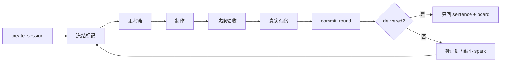

# Idea King

### 点子王 · 把一句话做成能试用的东西

> 一句点子，或一句没有出路的话进来。  
> 班组不写方案册——它点破、落地、试跑、验收，直到别人能直接动手。

对话只回两样东西：工具生成的 **`sentence`**，以及展板路径 **`boardPath`**。  
抓了什么、想了什么、做成了什么，一律以 `artifacts/<sessionId>/board.html` 为准。  
只有 `deliveryStatus = delivered`，才算交卷。

<br>

```
  原话 ──► 点破 ──► 思考 ──► 制作 ──► 试跑 ──► 观察 ──► delivered
```

<br>

## 为什么需要它

| 常见 AI 协作 | 点子王 |
|:---|:---|
| 有计划，没有可运行产物 | 成品必须落在 `out/`，可执行 |
| 有脚本，没有可复现验收 | CLI / 页面用例由代码硬验收 |
| 自称完成，没有真实观众 | `real` 观察 + `receipt` 才可能交付 |
| 换个说法就能绕过约束 | 两选项 · 四硬条件 · 阶段门 · 版本绑定 |

**本事先于题目。证据先于口号。能试用才算交卷。**

<br>

## 一句话看懂约定

```
literal  字面做法   照原话字面会做成的那件
spark    点破做法   交接成立时做成的那件（短名）

join         交接接得上
not_literal  不是原话的字面
try          别人能直接试用
memory       别人会记住：交接句本身
```

- 默认 `mode=ideaKing`：恰好 **2** 个选项 + **4** 条硬条件  
- `mode=lattice` 只做自由评议 / 夹具，**不算**点子王交付  
- **交接** = 一方产出正好是另一方输入；两个都会写字，不算一对

<br>

## 班组

人数 `crewSize`：**3 – 12**（默认 **5**）。创建时冻结 `crewPlan`。

```
                 ┌──────────── 脊柱三角 ────────────┐
                 │                                  │
              点子王  ────────►  制作手  ────────►  收尾手
           抓取·点破·冻结         落地·清单           试跑·交卷
                 │
                 └──── 多出来的名额 ────► 收集 → 分析 → 挑薄
```

| 角色 | 只做什么 | 不做什么 |
|:---|:---|:---|
| 点子王 | `deposit_grab` · 点破 · `confirm_marks` | 写实现 |
| 收集 / 分析 / 挑薄 | `deposit_think` · 补材料 | 成品 / 试跑 / 交卷 |
| 制作手 | `deposit_file` · `deposit_manifest` | 跳过冻结与思考门 |
| 收尾手 | `deposit_run` · `commit_round` | 代填真实观众 |

角色由当前任务槽推导；`callerRole` 只能对上当前槽，不能越权。

技能入口：[`.cursor/skills/idea-king/SKILL.md`](./.cursor/skills/idea-king/SKILL.md)

<br>

## 流程



| 步 | 动作 | 要点 |
|:--:|:---|:---|
| 1 | `create_session` | 存原话，不下结论 |
| 2 | `deposit_grab` → `confirm_marks` | ≥2 个真实文件；材料先于标记 |
| 3 | `deposit_think` | 次数 ≥ `max(0, crewSize − 3)` |
| 4 | `deposit_file` + `deposit_manifest` | 只写 `artifacts/<id>/out/` |
| 5 | `deposit_run` | QuickJS 沙箱；无网 / 无子进程 |
| 6 | 真实观察 | 三行 + `receipt`；模型不可代填 `real` |
| 7 | `commit_round` | 重验产物、清单、版本与凭证 |

没有「先制作再补冻结」的旁路。  
缩小点破时：**同身份替换**旧 `spark`，不是第三选项。材料或代码一变，旧运行 / 验收 / 观察全部作废。

<br>

## 快速开始

**环境** · Node.js（需 `--experimental-strip-types`）· 页面验收可选本机 Edge  

```bash
npm install
npm start            # MCP（stdio）
npm run settings     # 设置页 → http://127.0.0.1:3927/
npm test
npm run typecheck
```

Cursor MCP 见 [`.cursor/mcp.json`](./.cursor/mcp.json)（服务名 `pheromone-review`）。  
提到「点子王 / 凑班组 / 把点子做完」时，启用技能 **`idea-king`**。

### 设置（用页面，别手改 JSON）

配置落在 `.cursor/idea-king.json`：

| 键 | 默认 | 说明 |
|:---|:---|:---|
| `language` | `auto` | 原话含汉字 → 中文词表，否则英文 |
| `crewSize` | `5` | 夹到 3–12 |
| `spawnAgents` | `true` | 宿主不支持时，勿宣称已跑真实多人班组 |
| `theme` | `atelier` | 可自建 `.cursor/idea-king.themes.json` |

可选词表：`.cursor/idea-king.labels.json`

<br>

## 验收与交付

清单契约：`src/schema.ts` → `productManifestSchema`（入口相对 `out/`）

| 类型 | 最低要求 |
|:---|:---|
| **CLI** | ≥2 组不同输入 / 确定输出，并重复首例验确定性 |
| **页面** | ≥1 组真实 `fill` / `click` / `select`；结果须变化且精确匹配 |

```json
{
  "firstStop": "真实第一眼停下的位置",
  "skipped": "真实略过的内容",
  "remembered": "真实记住的话",
  "provenance": "real",
  "artifactHash": "观察界面给出的哈希",
  "receipt": "观察界面签发的凭证"
}
```

| `provenance` | 能否交付 |
|:---|:---|
| `real` + 绑定产物的 `receipt` | 才可能 `delivered` |
| `sim` | 仅诊断 |
| `unknown` | 未观察 · 不得交付 |

**沙箱边界** · QuickJS WASM · 只写 `out/` · 输出 4 MiB · 内存 64 MiB · 超时 5s · 快照与成品版本绑定

<br>

## 仓库地图

```text
.cursor/skills/idea-king/     技能与角色职责
docs/点子王.md                产品规格（权威）
docs/开发文档.md              lattice 历史规格（非交付）
src/                          引擎 · MCP · 验收 · 设置页 · runner
test/                         回归与硬化
artifacts/                    会话产物与展板（本地生成）
```

共用工具：  
`create_session` · `add_fact` · `confirm_marks` · `deposit_grab` · `deposit_think` · `deposit_file` · `deposit_manifest` · `deposit_run` · `commit_round` · `get_session`

<br>

## 文档

| | |
|:---|:---|
| [点子王规格](./docs/点子王.md) | 流程 · 验收 · 引用 · 边界 |
| [技能入口](./.cursor/skills/idea-king/SKILL.md) | 班组怎么做一轮 |
| [lattice 引擎](./docs/开发文档.md) | 底层格子规格 |

---

<sub>Private · 见 `package.json`。公开上传前请自行补协议与忽略规则。</sub>
