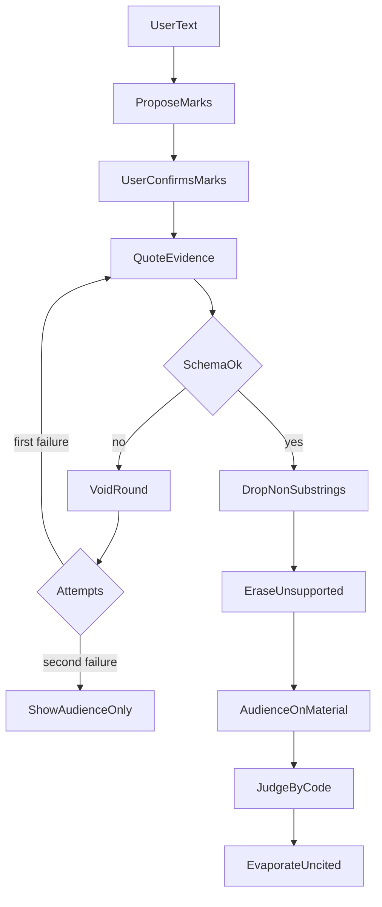

# 信息素评议开发文档

> **本文是 lattice 引擎 / 非点子王流程** 的底层规格。产品入口、班组、阶段门与交付状态以 [点子王.md](./点子王.md) 和 `.cursor/skills/idea-king/SKILL.md` 为准。A1–A5 与自由硬条件评议使用 `mode=lattice`；点子王默认 `mode=ideaKing`。

本文是实现规格。没写的行为就不做。后文若与第 1 节或第 2 节冲突，以这两节为准，并删掉冲突的句子。

产品只做选择评议。用户确认选项和硬条件之后，系统在格子上留下气味，再选定一个选项，或拒绝并指出还缺的那一个事实。搜集、擦除、下结论、旁观是四段固定管道，互相之间不对话。

---

## 1. 源标记与非目标

下面九条是源标记。实现、接口和测试都要能指回其中一条。不能改写它们来迁就实现。

1. 结果只有两种。选定，并指出是用户的哪一条硬条件决定的。或者拒绝，并指出还缺的那一个事实。若干选项都过线，或一个都不剩，也是拒绝，请用户再补一条硬条件。不存在第三种结论。
2. 不做开放式调研，不自动上网检索，角色之间不对话。
3. 搜集只在「硬条件 × 选项」上标记三种状态：有证据、没有证据、证据矛盾。证据必须是用户材料里的连续原句。
4. 质疑只删除站不住的引用，不写新词。跑题的句子不进格子。该硬条件若因此没有合格引用，格子仍是「没有证据」，气味保持 1。把一整行的气味改为 0，只按第 7 条做。
5. 源标记只来自用户确认过的原话。源标记气味恒为 1，不挥发。跑题的词没有格子。
6. 格子气味只有 0 或 1。回路气味只加在合格结论引用过的格子上。没被引用的格子，本轮结束就从下一轮的输入里清掉。
7. 第一位观众固定三行：第一眼停在哪、哪里滑过去、合上后只记得哪一句。硬条件若写成「别人会记住：某句」，而第三行不是这句，该主张气味为 0。
8. 聊天或无法解析的模型输出不进表。本轮作废，用本轮开始时的原表重跑，最多一次。第二次仍失败就停，只把观众的三行给用户。同一次输入在停止后不得再调用模型。
9. 新事实只能由用户补上，才成为新的源标记。模型不能自补事实或条件。

非目标：

- 不比较「30 分钟」和「40 分钟」的数值。`supports` 与 `contradicts` 由模型给出，代码只验收原句是不是材料里的连续子串。测试用夹具锁住关系词。
- 不打分，不使用浮点气味，不使用向量库，不做账号系统。
- 不把上一轮模型的原文放进下一轮的提示词。

事实标记不占表的行。它只进入材料，供原句核对。行如果包含「还没有写完的事实」，书记员会拒绝到错误的缺口，从而违反第 1 条。因此表的行只有硬条件。

---

## 2. 五条验收

后文不得写出会让这些结果失效的行为。标识在测试里保持不变。

| 标识 | 输入要点 | 期望 |
| --- | --- | --- |
| A1 | 选项「住处甲」「住处乙」，硬条件「每天要多久」，材料为空 | `{ "type": "refuse", "missingMarkId": "m_time" }`，页面只问「每天要多久」 |
| A2 | 在 A1 上追加硬条件「每天通勤不超过四十分钟」，并追加事实「住处甲单程 30 分钟。住处乙单程 50 分钟。」 | `{ "type": "select", "optionId": "m_a", "decidingMarkId": "m_limit" }` |
| A3 | 与 A2 相同，但模型多给一句「装修更现代」 | 该句不进格子。结论与 A2 相同。丢弃区有这句 |
| A4 | 选项「方案甲」「方案乙」，硬条件「别人会记住：离公司近」。观众第三行是「四十分钟」 | 该硬条件的格子 `scent` 全是 0。书记员的输入里没有这一行 |
| A5 | `quoteEvidence` 连续两次返回无法解析的原文「我们再讨论一下装修」 | `verdict` 为 `null`，`stopped` 为 `true`。不再第三次调用模型。响应里只有观众三行 |

A1 到 A5 的完整请求体写在第 9 节。这里的标识是后文「对应验收」所用的名字。

---

## 3. 技术选型

运行时是 Node 22 和 TypeScript，`strict` 打开。规则引擎是纯函数：不读网络，不读时钟，不读随机数。随机数只允许用来生成会话 id 和标记 id。

边界用 Zod。Cursor agent 交来的草稿先剥掉未知字段，再校验已知字段。剥掉以后仍不合法，才算无法解析。能解析但其中某句不是材料的连续子串，只丢掉那一句，不作废整轮。这样 A3 才不会把 A2 的结论一起毁掉。

模型就是当前的 Cursor agent。它只拟标记、交原句引用、交观众三行。不设置 `MODEL_BASE_URL`，也不另请求聊天接口。结论只由 `judge` 写成第 8 节的模板句。

入口有两个，都调用第 6 节同一组函数。stdio MCP 供本仓库的 IDE agent 和子代理使用，配置在 `.cursor/mcp.json`。命令行供只能跑命令的云端 agent 和 Cursor SDK 本地 agent 使用。SDK 若要挂工具，把同一个 stdio 命令放进 `mcpServers`。

会话是 `data/sessions/{id}.json`，先写临时文件再替换。无数据库，无网页。测试使用 Node 自带测试运行器，不连网，不读 Cursor 密钥。

依赖是 `zod` 和 `@modelcontextprotocol/sdk`。后者只为 MCP 入口。开发依赖是 `typescript` 和 `@types/node`。不引入 Web 框架、对话编排框架、搜索客户端或向量库。

### 复查 3

服务于第 2、6 条，以及 A3：解析失败和「一句跑题」必须分开。删掉了独立网页、OpenAI 兼容接口、搜索接口、浮点气味，以及用对话框架串起三个角色。工具例子写在第 6 节。

---

## 4. 数据契约

### 4.1 标记、引用、格子

`kind` 只允许 `option`、`constraint`、`fact`。

```ts
type DraftMark = { kind: "option" | "constraint" | "fact"; text: string }

type SourceMark = {
  id: string
  kind: "option" | "constraint" | "fact"
  text: string
  scent: 1
}

type Quote = {
  markId: string
  optionId: string
  quote: string
  relation: "supports" | "contradicts"
}

type Cell = {
  markId: string
  optionId: string
  status: "supported" | "missing" | "contradicts"
  scent: 0 | 1
  evidenceQuote: string | null
}
```

草稿没有 `id`，也没有气味。用户确认后，服务端分配 `id`，`scent` 固定为 1。`text` 去掉首尾空白后长度必须大于 0。同一次会话里，已经冻结的 `kind + text` 再确认一次，保持原 `id`，不新建。

格子只为 `kind === "constraint"` 的标记和每一个选项成对出现。`relation: "supports"` 写成 `supported`。`relation: "contradicts"` 写成 `contradicts`。这两种格子在通过原句检查后 `scent` 为 1，`evidenceQuote` 是该原句。没有任何合格引用的格子是 `missing`、`scent` 为 1、`evidenceQuote` 为 `null`。`missing` 仍然可见，它就是拒绝时要指出的缺口。`scent: 0` 表示书记员看不见这格，和 `missing` 不是一回事。

原句检查是 `quote.length > 0 && material.includes(quote)`，区分大小写，不做同义改写。

### 复查 4.1

服务于第 3、5、6 条。删掉了「事实也占一行」和「缺失就等于气味 0」。引用对象的例子见第 5 节，并由 `commit_round` 接收。

### 4.2 观众、结论、会话

```ts
type AudienceReport = {
  firstStop: string
  skipped: string
  remembered: string
}

type Verdict =
  | { type: "select"; optionId: string; decidingMarkId: string }
  | { type: "refuse"; missingMarkId: string }
  | { type: "refuse_tie" }

type Session = {
  id: string
  userText: string
  material: string
  draftMarks: DraftMark[]
  marks: SourceMark[]
  cells: Cell[]
  lastRoundCells: Cell[]
  audience: AudienceReport | null
  verdict: Verdict | null
  discardedText: string | null
  voidCount: number
  stopped: boolean
}
```

`AudienceReport` 的三行各自去掉空白后长度必须大于 0。结论只有上面三种对象。停住且没有合格结论时，`verdict` 是 `null`，这不是第四种结论。

`cells` 是挥发之后留给下一轮的格子，只含本结论引用过的格子。`lastRoundCells` 是书记员判定前的满表，包含 `scent: 0` 的行，供页面和 A4 使用。下一轮调用模型时不读取 `lastRoundCells`，也不读取 `discardedText`。

`voidCount` 是当前这一轮里 `quoteEvidence` 已经失败的次数。合格结论把它置为 0。

### 复查 4.2

服务于第 1、6、7、8 条，以及 A4、A5。删掉了 `score` 字段、第四种 `type`，以及把观众三行并成一段评语。会话读回的例子写在第 6 节 `get_session`。

---

## 5. 草稿与引擎端口

Cursor agent 只交三份草稿，不写会话，也看不到引擎内部的另一次输出。用户没有确认之前，草稿不是源标记。

| 草稿 | 谁产生 | 输入 | 输出 | 禁止 | 验收 |
| --- | --- | --- | --- | --- | --- |
| 标记草稿 | Cursor agent，在 `confirm_marks` 之前 | 用户原话 | `{ marks: DraftMark[] }`，先给用户看 | `scent`、`verdict`、用户没说的标准 | A1 |
| 引用草稿 | Cursor agent，交给 `commit_round` | 已冻结标记和材料 | `{ quotes: Quote[] }` | 新标记、结论、评语、不在材料里的句子 | A2、A3 |
| 观众草稿 | Cursor agent，交给 `commit_round` | 材料；作废时改为看本次无法解析的原文 | `AudienceReport` | 建议、第四行、结论 | A4、A5 |

标记草稿只从用户原话抽出选项、硬条件和已给事实。`kind` 只能是 `option`、`constraint`、`fact`。不要下结论，不要添加用户没说的标准。引用草稿只找材料中的连续原句；找不到就不要该格子。观众草稿只有三句。三次草稿互不引用。创建会话不解析草稿，失败重试只发生在 `commit_round`，见第 7 节。

### 复查 5 草稿

服务于第 2、3、7、9 条。删掉了单独的聊天模型和把三个角色放进同一条历史。引用草稿的形状是：

```json
{
  "quotes": [
    { "markId": "m_time", "optionId": "m_a", "quote": "住处甲单程 30 分钟", "relation": "supports" },
    { "markId": "m_time", "optionId": "m_b", "quote": "住处乙单程 50 分钟", "relation": "supports" },
    { "markId": "m_limit", "optionId": "m_a", "quote": "住处甲单程 30 分钟", "relation": "supports" },
    { "markId": "m_limit", "optionId": "m_b", "quote": "住处乙单程 50 分钟", "relation": "contradicts" }
  ]
}
```

引擎端口全部是同步纯函数。模型不能调用它们。

| 方法 | 谁调用 | 输入 | 输出 | 禁止 | 验收 |
| --- | --- | --- | --- | --- | --- |
| `freezeMarks` | `confirm_marks` | 会话，以及用户这次提交的 `{ kind, text }[]` | 追加后的 `SourceMark[]`，并为新硬条件补上空白格子 | 改已有原文、把 `scent` 写成 0、写入用户没提交的标记 | A1 |
| `applyQuotes` | 一轮之内 | 当前硬条件、选项、已通过检查的 `Quote[]` | 满表 `Cell[]` | 发明新标记、把 `missing` 写成 `scent: 0` | A1、A2 |
| `eraseUnsupported` | 紧接在 `applyQuotes` 之后 | 满表、材料 | 对不上的引用从格子里去掉；该格没有合格引用时保持 `missing` 且 `scent` 为 1 | 把跑题句留在 `evidenceQuote`、把整条硬条件改成 `scent: 0` | A3 |
| `applyAudience` | `watch` 成功之后 | 满表、`AudienceReport`、硬条件原文 | 记忆主张对不上时，该行 `scent` 改为 0 | 改其他行、写建议、改观众三行的文字 | A4 |
| `judge` | 擦除和观众之后 | 只含 `scent === 1` 的格子，以及标记顺序 | `Verdict` | 返回未冻结的 id、同时指出两个缺口、返回评分 | A1、A2 |
| `evaporate` | 合格结论之后 | 满表、`Verdict` | 下一轮可见的 `cells` | 删除源标记、把跑题句留在 `cells` | A2、A3 |
| `depositFact` | `add_fact` | 会话、用户原文 | 新增一条 `kind: "fact"` 且 `scent` 为 1 的标记，并把原文追加进 `material` | 改写原文、推断出第二条事实、顺便下结论 | A2 |

`freezeMarks` 的空白格子是 `missing`、`scent` 为 1、`evidenceQuote` 为 `null`。

`eraseUnsupported` 不调用模型。原句对不上材料或对不上现有标记时，删掉这句引用，不新建格子。同一格若还留着合格引用，`status` 和 `scent` 不变。同一格若已经没有任何合格引用，保持 `missing` 且 `scent` 为 1。跑题的词因此没有格子，真缺口仍留给书记员。整行改成 `scent: 0` 只由 `applyAudience` 做。

`applyAudience` 只处理原文匹配 `^别人会记住：(.+)$` 的硬条件。捕获的那一句必须与 `remembered` 完全相同，否则该 `markId` 下所有格子 `scent` 改为 0，`status` 和 `evidenceQuote` 不动。没有这个前缀的行不改。

`judge` 按标记确认顺序看硬条件，步骤固定：

1. 某一硬条件 `scent` 为 1 且 `status` 为 `contradicts` 的选项出局。
2. 尚未出局的选项上，若存在 `scent` 为 1 且 `status` 为 `missing` 的硬条件，返回 `refuse`。`missingMarkId` 是其中确认顺序最早的一条。不返回第二条。
3. 只剩一个选项，且至少有一条可见硬条件，并且它上面每条可见硬条件都是 `supported`：返回 `select`。`decidingMarkId` 是满足下面两点的硬条件里最早的一条：该选项在此为 `supported`，并且每个出局选项在此为 `contradicts`。调用方保证选项至少两个，见第 6 节。
4. 剩下的选项不是一个，或者没有任何 `scent` 为 1 的硬条件：返回 `refuse_tie`。

`evaporate` 的引用范围：`select` 留下 `decidingMarkId` 那一行里 `scent` 为 1 的格子；`refuse` 留下 `missingMarkId` 那一行里 `status` 为 `missing` 的格子；`refuse_tie` 留下所有 `scent` 为 1 的硬条件格子。源标记都不删除。

`depositFact` 把原文用一个换行追加到 `material` 末尾。原文为空则调用方在工具层拒绝，函数本身不写会话。

### 复查 5 引擎

服务于第 1、3、4、5、6、7、9 条。删掉了「全部出局」这第四种结论，把它并进已有的 `refuse_tie`。删掉了质疑员再调用一次模型，也删掉了「坏引用把整条硬条件气味改成 0」：那会把 A1 的缺口从书记员眼前拿掉。`judge` 对 A1 的结果是 `{ "type": "refuse", "missingMarkId": "m_time" }`。

---

## 6. 工具接口

MCP 和命令行调用同一组函数。错误只有 `{ "error": string }`。`error` 只取这些值：`bad_request`、`not_found`、`marks_not_frozen`、`need_two_options`、`stopped`。不返回堆栈。业务上的作废不是错误，而是会话里的 `voidCount` 和 `stopped`。成功响应都带 `sentence`。有结论时它是第 8 节的模板句；作废后它是「这轮没有结论。」

会话字段的形状：

```json
{
  "sessionId": "s_1",
  "error": null,
  "sentence": null,
  "verdict": null,
  "marks": [],
  "cells": [],
  "lastRoundCells": [],
  "audience": null,
  "discardedText": null,
  "voidCount": 0,
  "stopped": false,
  "retry": false
}
```

`create_session` 的调用者是 Cursor agent。输入是 `{ "userText": string, "material"?: string }`。`userText` 去掉空白后必须非空，否则 `bad_request`，不写文件。输出只有新的 `sessionId`，`marks` 仍为空。禁止返回 `verdict`，禁止在这一步冻结气味，禁止替用户抽出标记。对应的是保存原话，不是 A1 的结论。

```json
{ "userText": "住处甲和住处乙，我在意每天要多久", "material": "" }
```

`confirm_marks` 的调用者是 Cursor agent，且只在用户明确确认之后。输入是 `{ "sessionId": string, "marks": DraftMark[] }`。输出是冻结后的会话。只冻结正文里这些标记，并调用 `freezeMarks`。禁止把用户没确认的草稿一并冻结，禁止下结论。对应 A1 的确认，以及 A2 里追加硬条件。

```json
{
  "sessionId": "s_1",
  "marks": [
    { "kind": "option", "text": "住处甲" },
    { "kind": "option", "text": "住处乙" },
    { "kind": "constraint", "text": "每天要多久" }
  ]
}
```

确认后 `verdict` 为 `null`。`marks` 与空白 `cells` 形如：

```json
{
  "marks": [
    { "id": "m_a", "kind": "option", "text": "住处甲", "scent": 1 },
    { "id": "m_b", "kind": "option", "text": "住处乙", "scent": 1 },
    { "id": "m_time", "kind": "constraint", "text": "每天要多久", "scent": 1 }
  ],
  "cells": [
    { "markId": "m_time", "optionId": "m_a", "status": "missing", "scent": 1, "evidenceQuote": null },
    { "markId": "m_time", "optionId": "m_b", "status": "missing", "scent": 1, "evidenceQuote": null }
  ]
}
```

`m_a`、`m_b`、`m_time` 只是验收文档里的名字。实现可以用任意唯一字符串，但同一会话内不得改变。测试直接构造这些 id。

`add_fact` 的调用者是 Cursor agent。输入是 `{ "sessionId": string, "text": string }`。它只调用 `depositFact`。禁止改写 `text`，禁止下结论。对应 A2。`text` 为空则 `bad_request`，会话不变。

```json
{ "sessionId": "s_1", "text": "住处甲单程 30 分钟。住处乙单程 50 分钟。" }
```

`commit_round` 的调用者是 Cursor agent。输入是 `{ "sessionId": string, "quotes": string, "audience": string }`。两个字符串是 JSON 文本；解析在引擎里做，好让无法解析的原文也能进入第 7 节。输出是一轮之后的会话，并带 `sentence`。禁止返回源标记里不存在的 id，禁止在 `stopped === true` 时继续解析草稿。对应 A1 到 A5。还没有标记，或选项少于 2 个时，错误分别为 `marks_not_frozen` 和 `need_two_options`，会话不变。`stopped === true` 时错误为 `stopped`，会话不变。

`get_session` 的调用者是需要回放的 agent。输入是 `{ "sessionId": string }`。输出是当前会话，其中 `lastRoundCells`、`audience`、`verdict`、`discardedText`、`sentence` 必须保留。禁止在这个工具里下结论或调用模型。对应 A3 的丢弃区和 A5 的三行。未知 id 为 `not_found`。

用户再次 `confirm_marks` 或 `add_fact` 且真正写入了新标记时，把 `stopped` 置为 `false`，`voidCount` 置为 0。这不是重跑，因为新气味来自用户。只重复提交已存在的 `kind + text` 不算新标记，不得解除 `stopped`。

命令行和 MCP 的名字相同。命令行把 JSON 参数放在 `--quotes` 和 `--audience` 里，结果打印到标准输出。

### 复查 6

服务于第 5、8、9 条和全部五条验收的入口。删掉了网页路由、删除标记的接口、搜索参数，以及在创建会话时返回结论。A5 时 `verdict` 为 `null`，`stopped` 为 `true`，`audience` 为第 9 节那三行，`sentence` 为「这轮没有结论。」

---

## 7. 一轮状态机

一次 `commit_round` 是一次尝试。它开始时按当前源标记重新铺满空白表，不沿用上一轮的 `evidenceQuote`。材料仍然包含用户已经追加的事实。重跑是 agent 再调用一次 `commit_round`，不是引擎自己去找模型。



上图只画主路径。观众草稿不合法时，和引用草稿不合法一样，由 agent 再交一次，规则在下面的步骤里。

1. `stopped === true`，或冻结的选项少于 2 个，或还没有任何用户确认过的标记：按第 6 节返回错误，会话不变。
2. 解析本次提交的引用。输出不合法：原文写入 `discardedText`，再解析本次提交的观众三行；观众不合法时，这一次没有新的三行。不把原文放进下一次的提示。这次尝试失败，直接进入第 4 步。
3. 引用合法：删掉不是材料连续子串的项和对不上现有 id 的项。同一格有多条合格引用时只留第一条。丢掉的 `quote` 用换行写入 `discardedText`。然后 `applyQuotes`、`eraseUnsupported`。这不算尝试失败。接着解析观众三行。观众合法才 `applyAudience`，并进入第 5 步。观众不合法则这次尝试失败，不保留刚铺好的格子，直接进入第 4 步。
4. 尝试失败时 `voidCount` 加 1。同一次尝试里两处输出都不合法，也只加 1。加完仍小于 2：表恢复为本轮开始的空白表，`retry` 为 `true`，由 agent 再提交一次。加完等于 2：`stopped` 为 `true`，`verdict` 为 `null`，`cells` 与 `lastRoundCells` 都是这张空白表。若还没有任何一次合法的三行，三行都写成常量「没有看清」；否则用最后一次合法的三行。这三句常量不是模型补写的结论。
5. 尝试成功：`judge` 只接收 `scent === 1` 的格子。`evaporate` 写入 `cells`。`lastRoundCells` 保存 `judge` 之前的满表，包括 `scent` 为 0 的行。`voidCount` 置为 0。

A3 走第 3 步，不走第 2 步的失败分支。因此多出来的「装修更现代」不会触发重跑，A2 的结论保持不变。

### 复查 7

服务于第 4、6、8 条，以及 A3、A5。删掉了第三次重试、把作废原文塞回提示词、以及用观众的评语改写结论。A5 的期望响应写在第 9 节。

---

## 8. Agent 要原样说出的话

对话里展示五块：源标记列表、气味表、观众三行、`sentence`、本轮丢弃区。没有角色对话框，没有评分，没有第四块「综合建议」。

气味表的数据是 `lastRoundCells`。每一格显示选项、硬条件原文、`status`、`scent`、`evidenceQuote`。`scent` 为 0 的格子也显示，但要标明「书记员看不见」。`sentence` 不由 agent 改写，只用下面的模板：

- `select`：`选定「{选项原文}」，因为「{决定条件原文}」。`
- `refuse`：`还不能选。只缺：{missingMarkId 的原文}。`
- `refuse_tie`：`还不能选。请再补一条硬条件。`
- `verdict === null` 且已跑过一轮：`这轮没有结论。` 下面只展示观众三行。

A1 的 `sentence` 是「还不能选。只缺：每天要多久。」A2 的 `sentence` 是「选定「住处甲」，因为「每天通勤不超过四十分钟」。」

丢弃区展示 `discardedText`。A3 里这里出现「装修更现代」，表里没有这四个字。agent 可以把它给用户看，但不得把它写进下一次 `commit_round` 的提示。

调用顺序固定。先 `create_session`。标记草稿先给用户看，用户确认后才 `confirm_marks`。用户补上的事实才 `add_fact`。然后 agent 自己写出引用和观众三行，调用 `commit_round`。`retry` 为 `true` 时只用材料再交一次，不带着丢弃原文。`sentence` 有值时，对用户说的第一句必须与它逐字相同。

有 MCP 工具时走 MCP。没有时走同一套命令行。项目技能和子代理只在用户要做选择评议时进入这套顺序，不插进平时的写代码对话。

### 复查 8

服务于第 2、7 条，以及 A1、A2、A3 的可见结果。删掉了网页、星级评分，以及未经确认就冻结标记。A4 的三行例子是 `{ "firstStop": "离公司近", "skipped": "其余句子", "remembered": "四十分钟" }`。

---

## 9. 文件布局与测试

```
package.json
tsconfig.json
src/schema.ts
src/engine.ts
src/round.ts
src/session-store.ts
src/tools.ts
src/mcp.ts
src/cli.ts
test/accept.test.ts
.cursor/mcp.json
.cursor/skills/pheromone-review/SKILL.md
.cursor/agents/pheromone-review.md
```

`src/schema.ts` 放第 4 节的 Zod 对象。`src/engine.ts` 只放第 5 节的引擎函数。`src/round.ts` 按第 7 节跑一次 `commit_round`。`src/session-store.ts` 读写 `data/sessions`。`src/tools.ts` 是 MCP 和命令行共用的五个工具。`src/mcp.ts` 只做 stdio。`src/cli.ts` 只做命令行。`data/sessions` 运行时创建，不提交其中的 JSON。

`package.json` 的脚本：`npm test` 执行 `node --experimental-strip-types --test test/accept.test.ts`。`npm start` 执行 `node --experimental-strip-types src/mcp.ts`。

`tsconfig.json` 打开 `strict`，包含 `src` 和 `test`。

测试不听端口，不读密钥，不调用 Cursor。断言打在引擎输出和 `commit_round` 的返回值上。

标识在本节固定为：

- `m_a` 选项「住处甲」
- `m_b` 选项「住处乙」
- `m_time` 硬条件「每天要多久」
- `m_limit` 硬条件「每天通勤不超过四十分钟」
- `m_p` 选项「方案甲」
- `m_q` 选项「方案乙」
- `m_memory` 硬条件「别人会记住：离公司近」

A1。`freezeMarks` 确认 `m_a`、`m_b`、`m_time`。`material` 为 `""`。`commit_round` 的引用是 `{ "quotes": [] }`。观众是 `{ "firstStop": "每天要多久", "skipped": "没有时间", "remembered": "没有结论" }`。期望 `verdict` 为 `{ "type": "refuse", "missingMarkId": "m_time" }`，`sentence` 为「还不能选。只缺：每天要多久。」`lastRoundCells` 里两格都是 `missing`、`scent` 为 1。`discardedText` 为 `null`。

A2。在 A1 的标记上再冻结 `m_limit`，再 `depositFact("住处甲单程 30 分钟。住处乙单程 50 分钟。")`。引用是第 5 节那四条，不多不少。期望 `verdict` 为 `{ "type": "select", "optionId": "m_a", "decidingMarkId": "m_limit" }`，`sentence` 为「选定「住处甲」，因为「每天通勤不超过四十分钟」。」`cells` 里只剩 `m_limit` 这一行中 `scent` 为 1 的格子。`m_time` 不在 `cells` 里，因为它不是决定行。它仍在 `lastRoundCells` 里，两格都是 `supported`。

A3。标记、材料和 A2 相同。引用在 A2 的四条之外再加 `{ "markId": "m_limit", "optionId": "m_a", "quote": "装修更现代", "relation": "supports" }`。期望 `verdict` 与 A2 相同。任何一个格子的 `evidenceQuote` 都不是「装修更现代」。`discardedText` 为「装修更现代」。`voidCount` 为 0，`stopped` 为 `false`。

A4。冻结 `m_p`、`m_q`、`m_memory`。`material` 为「方案强调离公司近」。引用对两个选项都给出 `quote`「离公司近」、`relation`「supports」。观众是 `{ "firstStop": "离公司近", "skipped": "其余句子", "remembered": "四十分钟" }`。期望 `lastRoundCells` 里 `m_memory` 的两格 `scent` 都是 0。传给 `judge` 的格子列表为空。`verdict` 为 `{ "type": "refuse_tie" }`。源标记 `m_memory` 仍在，`scent` 仍是 1。

A5。标记与 A1 相同。第一次和第二次的引用都是字符串 `我们再讨论一下装修`，不是对象。观众是 `{ "firstStop": "我们再讨论一下装修", "skipped": "没有格子", "remembered": "没有结论" }`。期望第二次之后 `verdict` 为 `null`，`stopped` 为 `true`，`voidCount` 为 2，`discardedText` 为「我们再讨论一下装修」，`audience.remembered` 为「没有结论」，`sentence` 为「这轮没有结论。」第三次调用返回 `stopped`，会话不变。

再补一条断言：A2 提交的引用里没有 A5 的原文，也没有「装修更现代」。`create_session` 不写入标记。

### 复查 9

服务于全部源标记和 A1 到 A5。删掉了独立的评分测试、检索测试，以及需要真实密钥的测试。五个用例的输入和期望都已写在本节。

---

## 10. 覆盖检查

| 源标记 | 文档位置 | 验收 |
| --- | --- | --- |
| 1. 只有选定或拒绝，平局也是拒绝 | 第 4.2 节三种 `Verdict`；第 5 节 `judge` 第 4 步；第 8 节模板 | A1、A2、A4 |
| 2. 不调研、不检索、不对话 | 第 1 节非目标；第 3 节不引入的依赖；第 5 节三次草稿互不引用；第 8 节没有对话框 | A5 |
| 3. 三种状态，证据必须是原句 | 第 4.1 节 `Cell.status` 和 `material.includes`；第 5 节引用草稿 | A2、A3 |
| 4. 质疑只擦掉站不住的引用，不写新词；整行气味改为 0 只用于对不上的记忆主张 | 第 5 节 `eraseUnsupported` 与 `applyAudience`；第 7 节第 3 步 | A3、A4 |
| 5. 只有用户确认的原话，跑题没有格子 | 第 5 节 `freezeMarks`；第 6 节未勾选项不冻结；第 7 节第 3 步 | A3 |
| 6. 气味 0 或 1，回路只留引用格 | 第 4.1、4.2 节；第 5 节 `evaporate` | A2、A4 |
| 7. 观众只有三行，对不上则气味为 0 | 第 4.2 节；第 5 节 `watch` 与 `applyAudience` | A4、A5 |
| 8. 不进表，最多重跑一次，然后停止 | 第 7 节第 2、4 步；第 6 节 `stopped` 不改会话 | A5 |
| 9. 新事实只能用户补 | 第 5 节 `depositFact`；第 6 节 `add_fact` | A2 |

五条验收的输入和期望都在第 9 节，并在第 2 节有同一套标识。A3 的「结论不变」由第 7 节第 3 步保证：跑题的句子被丢掉，但不算一次失败。A5 的「只展示观众三行」由第 8 节 `verdict === null` 的模板保证。

覆盖检查时改过第 1 节第 4 条的写法，使它和第 6 条同时成立：坏引用不把整条硬条件改成 `scent: 0`，否则 A1 的缺口会从书记员眼前消失。`watch` 不合法和 `quoteEvidence` 不合法共用同一次尝试计数，避免停不住或停太早。同一格多条合格引用只留第一条，避免后一条悄悄盖住前一条。

第 5 节把「一个选项都不剩」并进 `refuse_tie`，这是第 1 条已经允许的拒绝，不是新结论。常量「没有看清」只在两次尝试都没有合法三行时使用。A5 的 `watch` 返回合法三行，不依赖这句常量。
